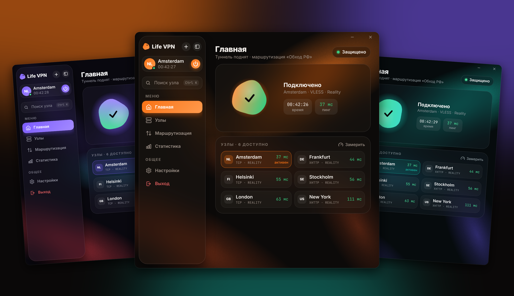
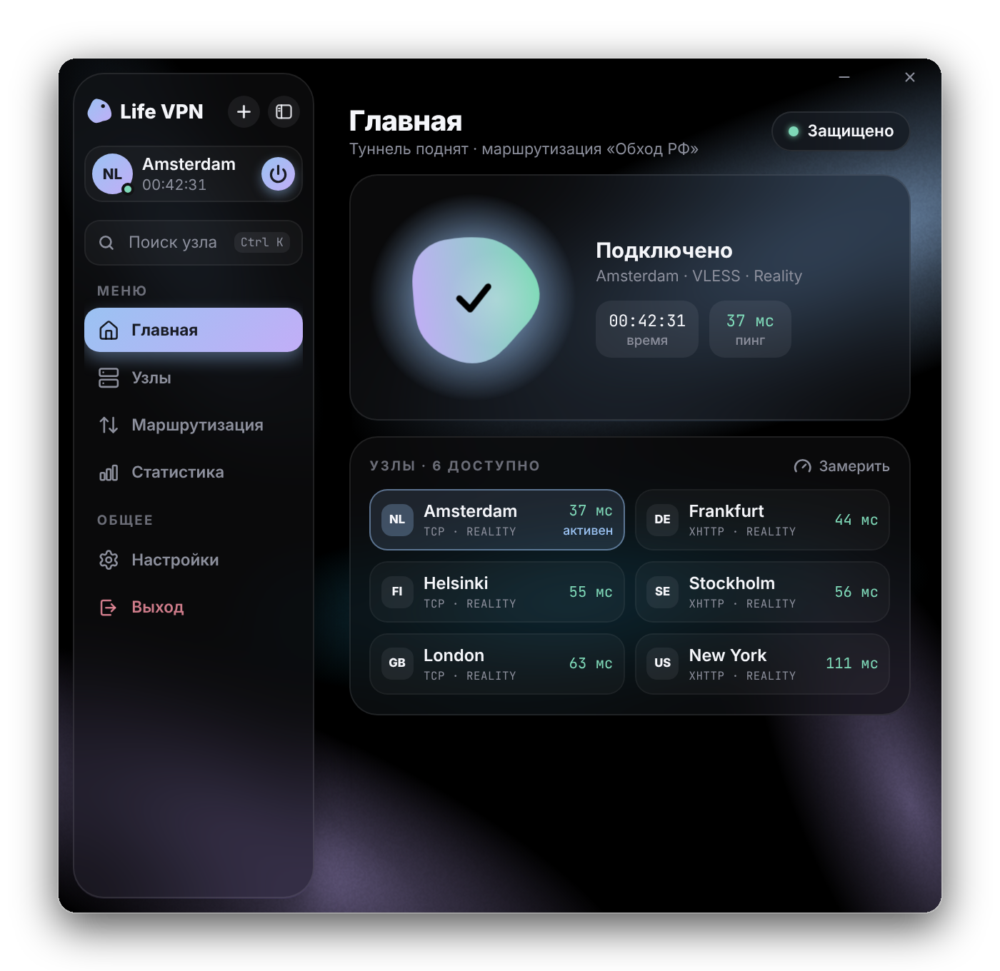
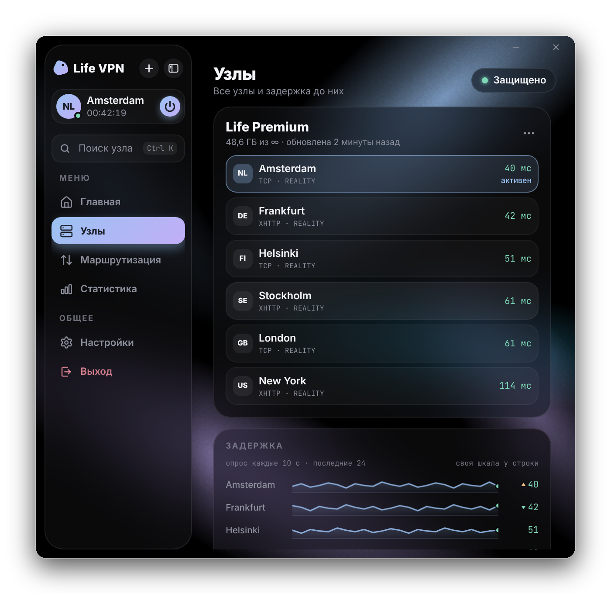
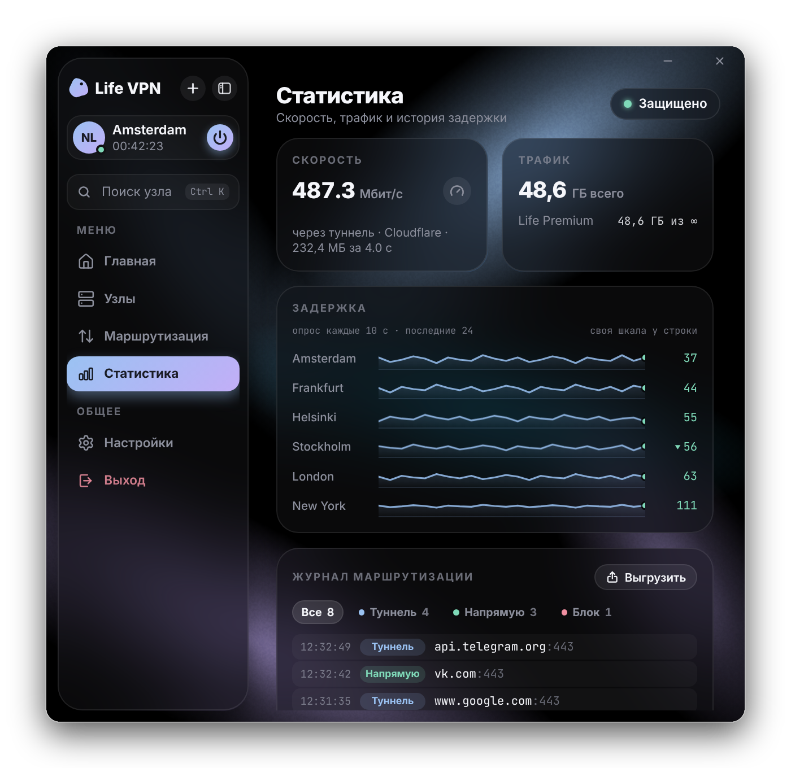
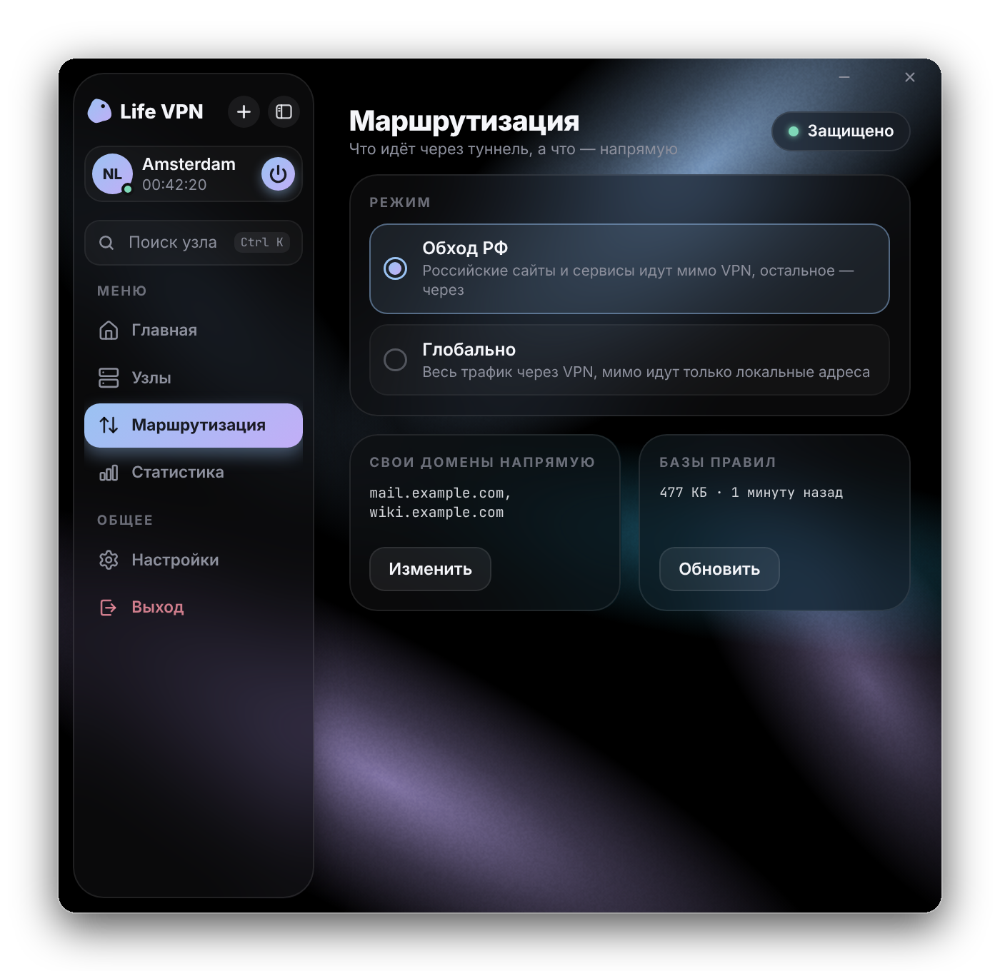
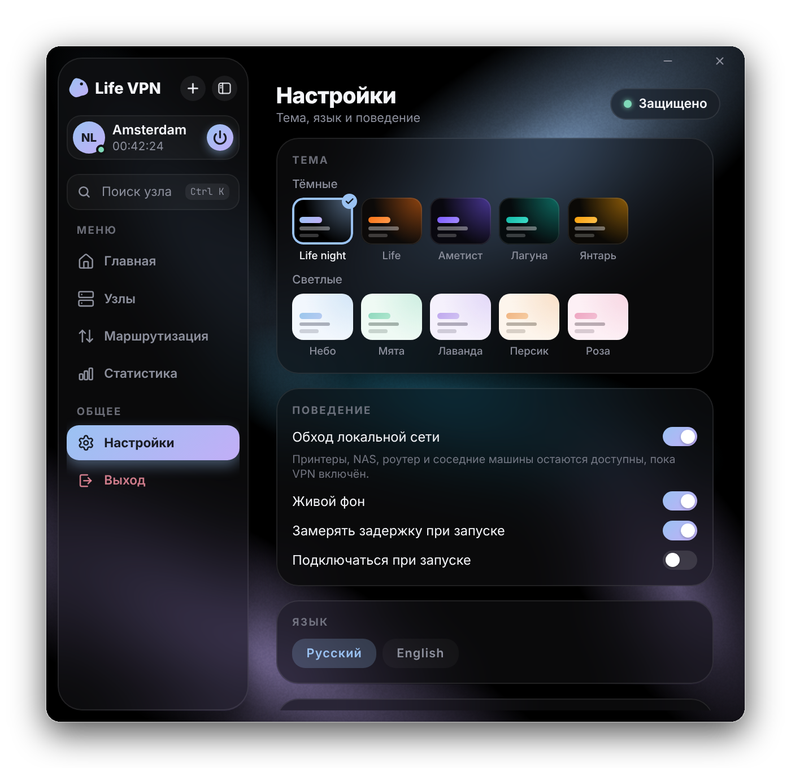
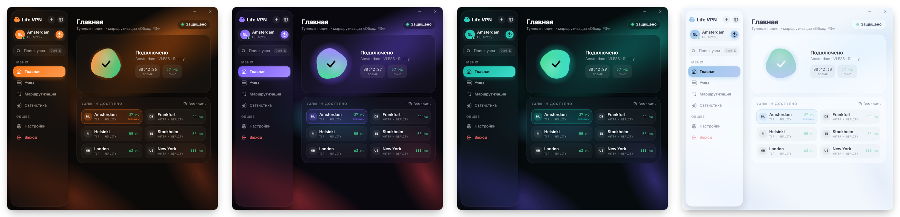

  

<h1 align="center">Life VPN</h1>

  <b>VPN для Windows, который хочется открывать.</b> 
  Одна кнопка, быстрые узлы и аккуратный интерфейс — без лишних экранов и настроек.

  
  
  
  

  <a href="https://github.com/stailegrow/LifeVPN-Win/releases/latest"><b>⬇ Скачать для Windows</b></a>
  &nbsp;·&nbsp; <a href="#установка">Установка</a>
  &nbsp;·&nbsp; <a href="https://github.com/stailegrow/lifevpn-macos">Версия для macOS</a>
  &nbsp;·&nbsp; <a href="#english">English</a>

---

## Одна кнопка — и вы под защитой

Нажали на живую кнопку — она вспыхивает искрами, а рядом бегут время сессии
и пинг до узла. Больше ничего делать не нужно: маршруты, DNS и системный прокси
Life VPN настраивает сам.

  

## Всё под рукой, ничего лишнего

<table>
  <tr>
    <td width="50%" valign="top">
      
      <h3>Узлы</h3>
      Все узлы подписки с живой задержкой. Поиск по <kbd>Ctrl</kbd>+<kbd>K</kbd> находит нужный за секунду.
    </td>
    <td width="50%" valign="top">
      
      <h3>Статистика</h3>
      Замер скорости, расход трафика, история задержки и журнал маршрутизации: видно, какой адрес ушёл в туннель, а какой напрямую.
    </td>
  </tr>
  <tr>
    <td width="50%" valign="top">
      
      <h3>Маршрутизация</h3>
      Российские сайты идут напрямую, остальное — через туннель. Свои домены и локальная сеть — мимо VPN.
    </td>
    <td width="50%" valign="top">
      
      <h3>Настройки</h3>
      Десять тем, живой фон, автоподключение при запуске, русский и английский.
    </td>
  </tr>
</table>

## Ваш цвет

Чёрная Life night, оранжевая Life, Аметист, Лагуна, Янтарь и пять
светлых тем.
Живой фон «северное сияние» переливается оттенками выбранной темы.

  

## Что внутри

**Подключение**
- VLESS с Reality и XTLS Vision, транспорт XHTTP — на свежем ядре Xray-core
- маршрутизация «Обход РФ»: российские сервисы напрямую, остальное через туннель
- раздельный DNS, обход локальной сети, свой список доменов «всегда напрямую»
- системный прокси Windows включается для всех подключений (включая модем и VPN Windows) и снимается при выходе, выключении компьютера и после сбоя

**Подписки**
- добавление ссылкой, из буфера обмена (<kbd>Ctrl</kbd>+<kbd>V</kbd> в окне), QR-кодом с камеры или с картинки
- список узлов обновляется сам: новые узлы на панели появляются в приложении, удалённые исчезают
- трафик, срок действия и переименование подписки

**Измерения**
- задержка меряется напрямую от вашего компьютера до узла — честная цифра, подключены вы или нет
- фоновый опрос раз в десять секунд и мини-графики истории по каждому узлу
- замер скорости по трём независимым источникам
- журнал маршрутизации: каждое соединение с пометкой «туннель», «напрямую»
  или «блок», выгрузка в .txt

**Удобство**
- значок в трее: зелёный, когда туннель поднят; левый клик — окно, правый — меню
- компактное окно с боковой панелью, которую можно свернуть до значков
- обновления приходят сами — одной кнопкой, без ручной переустановки

## Установка

1. Скачайте `LifeVPN-Setup-<версия>.exe` со страницы [последнего релиза](https://github.com/stailegrow/LifeVPN-Win/releases/latest).
2. Запустите установщик. Права администратора не нужны: приложение ставится
   в папку пользователя, ярлыки появляются на рабочем столе и в меню «Пуск».
3. Установщик не подписан сертификатом, поэтому Windows SmartScreen при первом
   запуске может показать предупреждение: «Подробнее» → «Выполнить в любом случае».

Нужна версия без установки — берите `LifeVPN-<версия>-x64.zip`: распакуйте
и запустите `LifeVPN.exe`. Такая копия сама не обновляется — новая версия
открывается в браузере.

Закрытие окна крестиком не завершает приложение: оно остаётся в трее вместе
с поднятым туннелем. Выйти — пункт «Выход» в боковой панели или правый клик
по значку в трее.

Дальше Life VPN обновляется сам: когда выходит новая версия, в боковой панели
появляется карточка «Доступна версия…». Одна кнопка — и приложение скачивает
установщик, ставит его тихо и перезапускается.

**Требования:** Windows 10 или 11, 64-бит.

## Приватность

Никакой аналитики, телеметрии и учётных записей. Подписки, настройки и список
узлов хранятся только на вашем компьютере, в `%APPDATA%\LifeVPN`. Само
приложение обращается только туда, где без этого не обойтись:

- к серверу вашей подписки — чтобы обновить список узлов;
- к самим узлам — чтобы измерить задержку;
- к CDN jsDelivr — за базами правил маршрутизации;
- к GitHub — чтобы проверить, вышла ли новая версия;
- к Cloudflare, Hetzner и CacheFly — только когда вы сами нажимаете «Проверить скорость».

## Лицензия

Life VPN — проприетарный продукт, все права защищены. Код открыт **только для
просмотра**. Копировать, изменять, собирать, распространять и создавать форки
для использования запрещено. Также запрещено копировать дизайн. Подробно — в
[LICENSE](LICENSE), условия для пользователей приложения — в [EULA.md](EULA.md).

Кнопка «Fork» на GitHub доступна у любого публичного репозитория — так
устроены правила GitHub, и отключить её нельзя. Но форк остаётся только
копией для просмотра: собирать из него приложение, менять или распространять
код лицензия не разрешает.

Ядро [Xray-core](https://github.com/XTLS/Xray-core) — отдельная программа под
лицензией MPL-2.0.

---

## English

**Life VPN is a Windows VPN client you'll actually enjoy opening.** One button,
fast nodes and a clean, focused interface.

- **One-tap connect.** The living button flares up, and the session timer
  and latency appear beside it. Routing, DNS and the system proxy are handled
  for you.
- **Nodes, statistics and routing** in a compact window with a collapsible
  sidebar and <kbd>Ctrl</kbd>+<kbd>K</kbd> search.
- **VLESS with Reality, XTLS Vision and XHTTP** on a current Xray-core.
- **Subscriptions** by link, clipboard, camera QR or image, kept in sync
  automatically.
- **Honest latency**, measured straight from your PC to each node, with
  per-node history graphs and a speed test across three sources.
- **Routing log**: see which address went through the tunnel or direct, and
  export it to .txt.
- **Ten themes** and a living aurora background.
- **Automatic updates**: new versions install with one click.

**Install:** download `LifeVPN-Setup-<version>.exe` from the
[latest release](https://github.com/stailegrow/LifeVPN-Win/releases/latest)
and run it — no admin rights needed. The installer is unsigned, so SmartScreen
may warn on first launch: More info → Run anyway. Requires Windows 10 or 11, 64-bit.

**Privacy:** no analytics, no telemetry, no accounts. Data stays on your PC.

**Licence:** proprietary, all rights reserved. The source is published for
viewing only. Copying, modifying, building, distributing, using forks and
copying the design are prohibited. See [LICENSE](LICENSE) and
[EULA.md](EULA.md).
